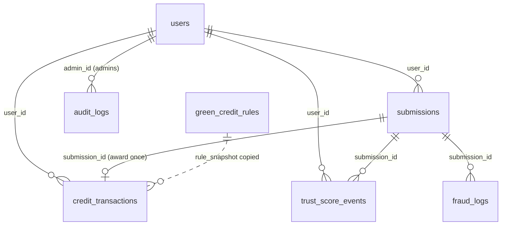

# Carbon Guard database schema (MongoDB)

Owner: **Antony** (agreed with Anamika). Database name: `carbon_guard` (`DATABASE_NAME` in `backend/.env`).

Only the FastAPI backend connects to MongoDB, through PyMongo. The Flutter app and the React dashboard
**never** connect to the database; they use the API in `API_CONTRACT.md`.

* Ids are MongoDB `ObjectId`s. The API sends them as 24-character strings.
* All times are stored as **UTC** (`datetime`, without time-zone info) and sent by the API with a `Z`.
* Images are **not** stored in MongoDB. Files live in `backend/uploads/` (development storage); the
  database stores only the file name, URL path and hashes.
* Indexes are created by `backend/database.py` → `create_indexes()` every time the backend starts
  (safe to repeat). The same function is used by `database/scripts/init_db.py`.
* Field names and allowed values are shared with the API. Changing one means updating
  `API_CONTRACT.md`, this file, the backend models, the dashboard and the app together.

## Collections

| Collection | Purpose | Written by |
|---|---|---|
| `users` | Accounts, roles, current Trust Score and credit balance | register, startup (admin), admin actions |
| `submissions` | One environmental activity with its evidence and results | app upload, background checks, admin actions |
| `green_credit_rules` | Credits per unit for each activity type | startup defaults, admin |
| `credit_transactions` | Append-only record of every credit award | admin approval |
| `trust_score_events` | Append-only record of every Trust Score change, with the reason | admin decisions |
| `fraud_logs` | One entry per submission that raised review flags | background checks |
| `audit_logs` | Every admin action (approve, reject, rule changes, user changes) | admin actions |
| `settings` | One document (`key: "verification"`) with scoring settings | startup defaults, admin |
| `geocode_cache` | Cached address lookups (Nominatim usage policy) | background checks |

### `users`

| Field | Type | Notes |
|---|---|---|
| `_id` | ObjectId | |
| `name` | string | 1-100 characters, trimmed |
| `email` | string | lower-case, **unique index** |
| `password_hash` | string | bcrypt hash. **Never** returned by the API |
| `role` | string | `user` or `admin`. Register always creates `user` |
| `trust_score` | double | starts at `trust_initial` (50); kept within 0-100 by the backend |
| `green_credits_total` | double | sum of this user's `credit_transactions.amount` |
| `is_active` | bool | `false` = cannot log in |
| `created_at`, `updated_at` | date | UTC |

### `submissions`

| Field | Type | Notes |
|---|---|---|
| `_id` | ObjectId | |
| `user_id` | ObjectId | → `users._id` |
| `user_email` | string | copy of the email at submission time (fast admin search) |
| `activity_type` | string | `tree_plantation`, `solar_panel`, `water_harvesting` |
| `image_filename` | string | random `uuid4` name in `backend/uploads/` |
| `image_url` | string | `/uploads/<image_filename>` |
| `image_hash` | string | SHA-256 of the file bytes (exact duplicates). Indexed |
| `image_dhash` | string | 64-bit perceptual hash, 16 hex characters (similar images) |
| `image_width`, `image_height` | int | pixels |
| `gps` | object | `{lat: double, lng: double, accuracy_m: double or null, is_mocked: bool or null}`. Indexed on `lat`, `lng` |
| `description` | string or null | max 500 characters |
| `scale_value` | double | trees / kW / m³ (see API_CONTRACT.md) |
| `status` | string | `processing`, `pending`, `manual_review`, `verified`, `rejected` |
| `ai_verification` | object or null | `{status, model, predicted_class, confidence, matched, scores, warnings}` |
| `location_verification` | object or null | `{gps_valid, accuracy_m, accuracy_ok, address, geocoding_status, notes}` |
| `satellite_verification` | object or null | `{status, source, acquisition_date, cloud_cover, image_url, ndvi_mean, supports_claim, notes}` |
| `fraud_check` | object or null | `{is_duplicate_image, is_duplicate_location, suspicious_pattern, flags, reasons, related_submission_ids}` |
| `verification_score` | double or null | 0-100 |
| `score_components` | object | `{ai, gps, satellite, fraud}` points |
| `decision_reasons` | array of strings | plain-language explanation of the score and result |
| `processing_error` | string or null | set when the automatic checks crashed (the record is kept) |
| `environmental_impact` | object | `{co2_estimate, unit}`; `null` values until verified |
| `green_credits_awarded` | double | 0 until an admin approves |
| `review_round` | int | starts 0; +1 each time a rejected submission is reopened |
| `reviewed_by` | string or null | admin email of the last decision |
| `review_notes` | string or null | admin's note, shown to the user |
| `reviewed_at`, `created_at`, `updated_at` | date | UTC |

Indexes: `(user_id, created_at desc)`, `(status, created_at desc)`, `image_hash`, `(gps.lat, gps.lng)`.

The four evidence objects are `null` while `status` is `processing`.

### `green_credit_rules`

| Field | Type | Notes |
|---|---|---|
| `activity_type` | string | **unique index** |
| `base_credit_value` | double | 0-10000 |
| `impact_multiplier` | double | 0-100 |
| `is_active` | bool | inactive rule → approvals award 0 credits |
| `updated_by` | string or null | admin email |
| `updated_at` | date | |

Defaults: tree 3, solar 5, water 4; multiplier 1; all active. Every change also writes an `audit_logs`
entry with the before and after values.

### `credit_transactions`

| Field | Type | Notes |
|---|---|---|
| `user_id` | ObjectId | |
| `submission_id` | ObjectId | |
| `type` | string | `award` |
| `amount` | double | |
| `rule_snapshot` | object | `{base_credit_value, impact_multiplier, is_active}` used for this award |
| `created_at` | date | |

**Unique index `(submission_id, type)`**: the database itself refuses a second award for the same
submission, even if two requests arrive at the same moment.

### `trust_score_events`

| Field | Type | Notes |
|---|---|---|
| `event_key` | string | `<submission_id>:<review_round>:<event_type>`, **unique index** (no double counting) |
| `user_id` | ObjectId | |
| `submission_id` | ObjectId | |
| `event_type` | string | `verified_submission`, `rejected_submission`, `fraud_confirmed`, `review_reopened` |
| `score_delta` | double | the change actually applied after the 0-100 bounds |
| `score_after` | double | Trust Score after this event |
| `reason` | string | plain-language reason shown to the user |
| `created_at` | date | |

Invariant: for every user, `users.trust_score` equals the `score_after` of their latest event (or 50 if
they have none). `database/scripts/check_integrity.py` checks this.

### `fraud_logs`

`{submission_id, user_id, flags: [string], reasons: [string], related_submission_ids: [ObjectId], created_at}`.
Index on `submission_id`.

### `audit_logs`

`{admin_id, admin_email, action, target_type, target_id, details: object, created_at}`.
Actions: `submission_approved`, `submission_rejected`, `submission_sent_to_review`, `credit_rule_updated`,
`config_updated`, `user_activated`, `user_deactivated`. Index on `created_at desc`.

### `settings`

One document `{key: "verification", ...}` holding the scoring settings listed in `API_CONTRACT.md`
section 4 (`weights`, `recommend_threshold`, `ai_min_confidence`, `gps_max_accuracy_m`,
`duplicate_location_radius_m`, `similar_image_max_distance`, `max_submissions_per_10min`, `max_scale`,
`satellite_min_ndvi`, `trust_initial`, `trust_min`, `trust_max`, `trust_rules`, `impact_factors`).
Missing keys fall back to the defaults in `backend/repositories/config_store.py`. **Unique index** on `key`.

### `geocode_cache`

`{key: "<lat rounded to 4>,<lng rounded to 4>", address, created_at}`. **Unique index** on `key`.
Safe to delete at any time.

## Data integrity rules (enforced by the backend, checked by `check_integrity.py`)

1. `users.green_credits_total` = sum of that user's `credit_transactions.amount`.
2. `users.trust_score` = `score_after` of the user's latest trust event (or the initial value).
3. Every `verified` submission has exactly one `award` transaction; no other status has one.
4. `submissions.green_credits_awarded` = the amount of its award transaction (0 if none).
5. Every `submissions.user_id` points to an existing user.
6. Trust Scores are within `trust_min`..`trust_max`.
7. Every image file referenced by a submission exists in the upload folder.

## Demo data, backup and cleanup

See `database/README.md` for seeding synthetic demo data, removing it, checking integrity, and
backing up / restoring with MongoDB Database Tools (`mongodump` / `mongorestore`).
