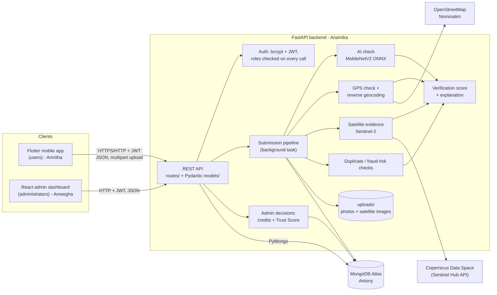
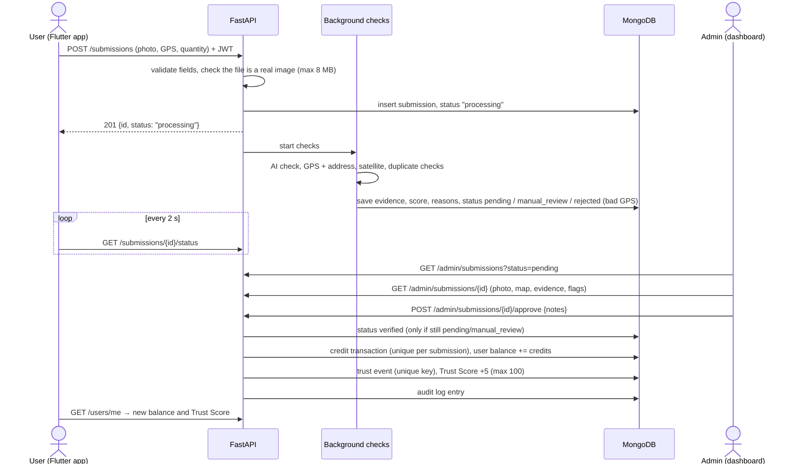
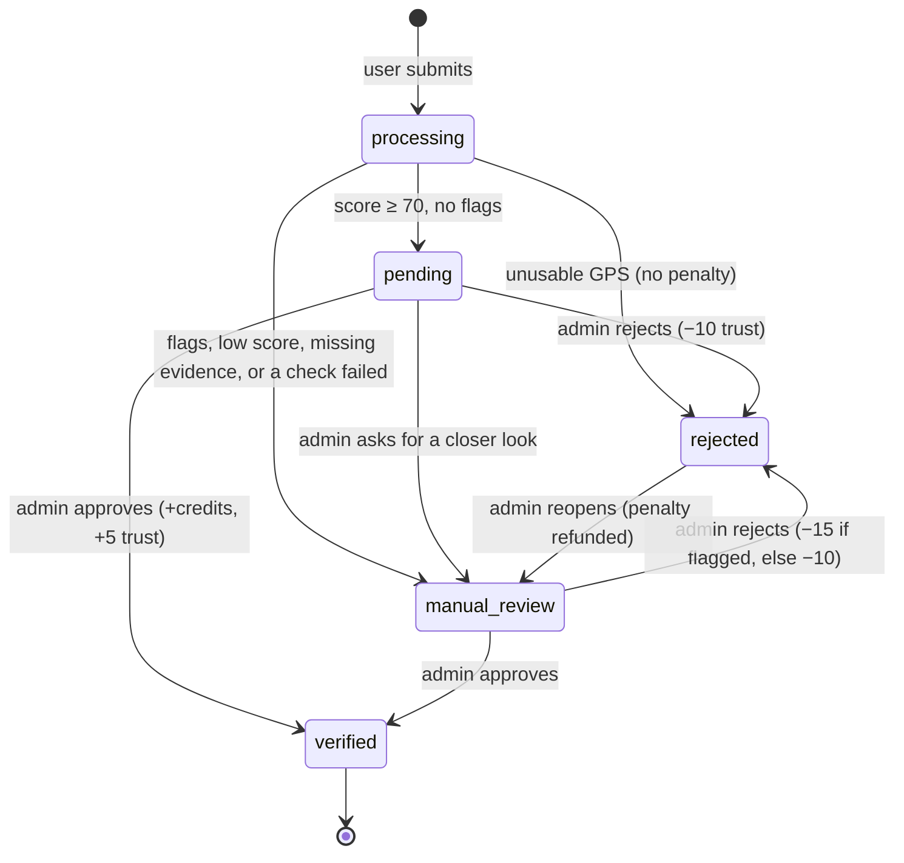

# Carbon Guard system architecture

## Components

Rules:
* The app and the dashboard talk **only** to the API. Only the backend connects to MongoDB.
* All verification services live **inside the one backend** as separate modules (no microservices).
* The backend is the only authority for logins, roles, scores, credits and Trust Scores.

## Backend modules (`backend/`)

| Concern | Files |
|---|---|
| Settings from `.env` | `config.py` |
| Database connection, indexes, defaults | `database.py` |
| Login check, admin check | `auth_utils.py`, `services/auth_service.py`, `services/rate_limit.py` |
| API routes | `routes/auth.py`, `users.py`, `submissions.py`, `admin.py`, `info.py`, `views.py` |
| Request/response schemas | `models/common.py`, `user.py`, `submission.py`, `admin.py` |
| Data access (one file per collection group) | `repositories/users.py`, `submissions.py`, `ledger.py`, `credit_rules.py`, `config_store.py` |
| Image storage + hashing | `services/image_utils.py` |
| Submission pipeline | `services/pipeline.py` |
| AI verification | `services/ai_verification.py` |
| Location verification | `services/location_verification.py`, `services/geocoding.py` |
| Satellite evidence | `services/satellite.py` |
| Fraud detection | `services/fraud_detection.py` |
| Verification score | `services/verification_engine.py` |
| Admin decisions | `services/review.py` |
| Green Credits, Trust Score | `services/credits.py`, `services/trust.py` |
| External HTTP | `services/http_client.py` |

## Submission workflow

If any check crashes, the submission is kept and moved to `manual_review` with a note. Nobody is penalised.

## Status lifecycle

## Security measures

| Measure | Where |
|---|---|
| Passwords hashed with bcrypt, never returned | `services/auth_service.py`, models without `password_hash` |
| JWT (HS256), 24 h lifetime, secret only in `.env` | `services/auth_service.py`, `config.py` |
| Role read from the database on every request; deactivated users blocked | `auth_utils.py` |
| Admin endpoints check the role in the backend (not only hidden in the UI) | `routes/admin.py` (`require_admin`) |
| Other users' submissions return 404 | `routes/submissions.py` |
| Image validation: real JPEG/PNG/WEBP, max 8 MB, random file names | `services/image_utils.py` |
| Credits and trust events cannot be applied twice (unique indexes + atomic status change) | `database.py`, `repositories/submissions.set_status_if` |
| Login/register rate limit (10/min/IP) | `services/rate_limit.py` |
| Validation errors never echo submitted values; server errors are generic | `main.py` |
| CORS limited to configured dashboard origins | `main.py`, `CORS_ORIGINS` |
| Search input escaped (not a regex) | `repositories/helpers.contains` |
| Audit log of every admin action | `repositories/ledger.add_audit_log` |
| App token in Android encrypted storage | `mobile_app/lib/state/session.dart` |
| `.env`, uploads, model weights, backups ignored by Git | `.gitignore` |
